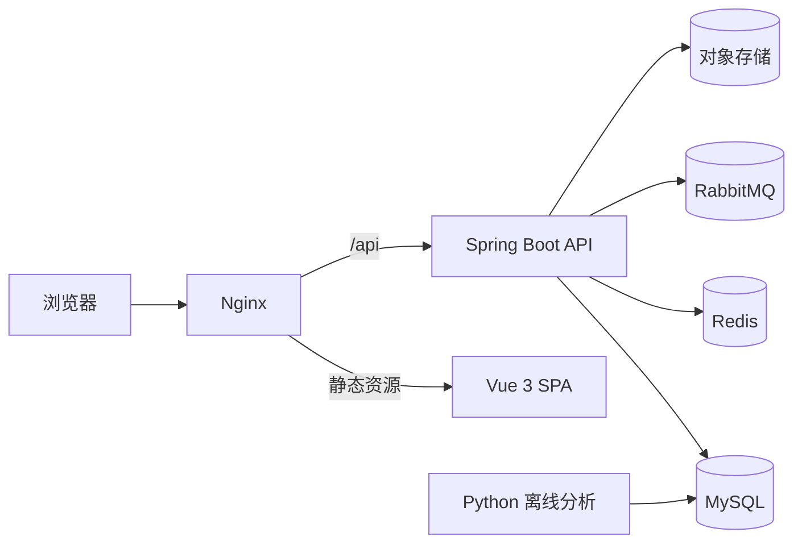

# DreamHiring 招聘平台

DreamHiring 是一个面向求职者、招聘企业和平台管理员的招聘平台，覆盖职位浏览与发布、简历管理、投递流程、站内消息、企业认证、运营管理和招聘数据分析。

项目采用前后端分离架构，后端提供 RESTful API，前端默认使用本地 Mock 数据以便独立预览。生产环境由 Nginx 托管静态资源并反向代理 API，基础设施包括 MySQL、Redis、RabbitMQ 和对象存储。

## 功能概览

| 角色 | 主要能力 |
|---|---|
| 求职者 | 注册登录、搜索职位、查看职位详情、维护简历、上传附件、投递职位、跟踪进度、接收站内消息 |
| 企业 HR | 企业认证、发布和管理职位、筛选候选人、更新投递状态、维护企业资料 |
| 平台管理员 | 用户与企业审核、职位和内容管理、运营公告、操作日志、死信消息查询与重投、数据大屏 |

平台还提供以下工程能力：

- JWT 身份认证和基于角色的接口权限控制。
- 验证码、登录与注册接口限流，并在 Redis 故障时回退到本地计数。
- 投递状态通知通过 RabbitMQ 异步投递，支持重试、死信归档和管理员重投。
- OSS 媒体文件上传，按文件头校验真实类型，数据库只保存对象键。
- 招聘数据离线清洗、技能词频分析，以及数据大屏聚合展示。
- OpenAPI 契约、后端集成测试、前端单元测试和离线分析测试。

## 技术架构



### 技术栈

| 层次 | 技术 |
|---|---|
| 后端 | JDK 21、Spring Boot 3.5、Spring Security、JWT、MyBatis、PageHelper |
| 前端 | Vue 3、Vite、Element Plus、Pinia、Vue Router、Axios、ECharts |
| 基础设施 | MySQL 8、Redis、RabbitMQ、阿里云 OSS、Nginx、systemd |
| 数据分析 | Python、pandas、NumPy |
| 测试与文档 | JUnit 5、Vitest、Node.js Test Runner、OpenAPI |

## 目录结构

```text
.
├── backend/               # Spring Boot API、数据库脚本与离线分析
├── frontend/              # Vue 3 单页应用
├── data/raw/              # 原始招聘分析数据
├── docs/api/              # API 说明、OpenAPI 契约与契约测试
└── deploy/                # Nginx、systemd 与发布脚本
```

## 快速开始

### 仅运行前端

前端开发环境默认启用 Mock，不需要先启动后端。

环境要求：

- Node.js 20.19+ 或 22.12+
- npm 10+

```bash
cd frontend
npm install
npm run dev
```

打开终端输出的本地地址，通常为 `http://localhost:5173`。

Mock 演示账号：

| 角色 | 用户名 | 密码 |
|---|---|---|
| 求职者 | `linzhixia` | `dreamhiring` |
| 企业 HR | `chenyu_hr` | `dreamhiring` |
| 管理员 | `admin_zhou` | `dreamhiring` |

### 运行完整前后端

环境要求：

- JDK 21
- Maven 3.9+
- MySQL 8
- Redis
- RabbitMQ
- 可用的 OSS 配置，或将对象存储切换为本地占位模式

1. 在 MySQL 中执行 `backend/db/mysql-schema.sql` 创建数据库和表。
2. 创建 `backend/src/main/resources/application-dev.yml`，配置 MySQL、Redis、RabbitMQ 和 OSS。该文件已被忽略，不能提交真实凭据。
3. 启动后端：

```bash
cd backend
mvn spring-boot:run
```

4. 前端连接真实后端，在 `frontend/.env.development.local` 中设置：

```dotenv
VITE_USE_MOCK=false
VITE_API_BASE_URL=http://localhost:8080/api
```

5. 启动前端：

```bash
cd frontend
npm run dev
```

后端详细配置、数据库升级和基础设施验证见 [后端说明](backend/README.md)；前端 Mock 与联调说明见 [前端说明](frontend/README.md)。

## 测试

### 后端

```bash
cd backend
mvn clean test
```

后端测试使用 H2 MySQL 兼容模式，不依赖本机 MySQL、Redis 或 RabbitMQ。

### 前端

```bash
cd frontend
npm test
npm run build
```

### 离线分析

安装 pandas 和 NumPy 后，在项目根目录执行：

```bash
python -m unittest discover -s backend/analysis/tests -p "test_*.py"
```

### 文档、部署与仓库检查

```powershell
powershell -NoProfile -ExecutionPolicy Bypass -File docs/api/tests/run-tests.ps1
powershell -NoProfile -ExecutionPolicy Bypass -File docs/architecture/tests/run-tests.ps1
powershell -NoProfile -ExecutionPolicy Bypass -File deploy/tests/run-tests.ps1
```

架构文档检查在缺少私有工程文档时会自动跳过对应检查项。

## 接口文档

- 业务规则与接口说明：[docs/api/README.md](docs/api/README.md)
- 机器可读 OpenAPI 契约：[docs/api/openapi.json](docs/api/openapi.json)
- 默认服务地址：`http://localhost:8080`
- API 前缀：`/api`
- 鉴权方式：`Authorization: Bearer <accessToken>`

修改接口后，应同步更新 OpenAPI 生成器并重新生成契约：

```bash
node docs/api/generate-openapi.mjs
```

## 部署

仓库提供 Nginx 反向代理、systemd 服务、生产环境变量模板和 PowerShell 发布脚本。完整流程见 [部署说明](deploy/README.md)。

生产环境必须通过环境变量或受限权限的服务器配置文件提供数据库、Redis、RabbitMQ、JWT 和 OSS 凭据。真实凭据不应写入仓库。

## 数据与许可

离线分析使用阿里云天池招聘数据集 `163746`，原始文件位于 `data/raw/数据分析.csv`。数据来源、字段说明、清洗口径、校验值和许可证状态见 [数据说明](backend/analysis/sources/tianchi-163746.md)。

该数据集的公开再分发许可证尚未得到确认。仓库包含数据文件不代表已获得额外授权，使用或再利用前应自行确认适用许可与合规要求。项目代码的许可证也尚未单独声明。
